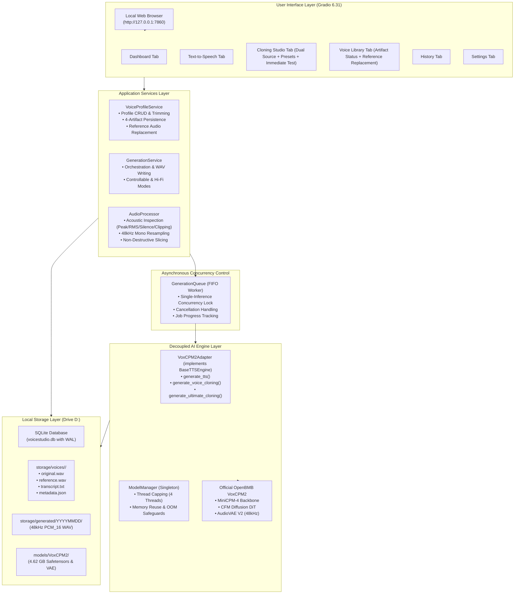

# VoiceStudio AI — System Architecture Document
**Version:** 0.3.0 (Stage 3 Voice Cloning Studio & Reference Audio Management)  
**Host Environment:** Windows 11 64-bit | Intel Core i5-1240P | Intel Iris Xe Graphics | 16GB RAM  
**Repository Location:** `D:\Coding\Rak'sTTS`  

---

## 1. High-Level Architecture Overview

VoiceStudio AI is designed as a local-only, decoupled desktop speech studio engineered around the constraints of modern foundation AI models running on consumer mobile CPU hardware without CUDA acceleration.

---

## 2. Component Design & Responsibilities

### 2.1 Model Manager (`app/engines/model_manager.py`)
* **Singleton Lifecycle:** Manages a single cached instance of `openbmb/VoxCPM2`.
* **Thread Capping:** Restricts PyTorch intra-op parallelism to **4 threads** (`torch.set_num_threads(4)`), reserving the remaining 8 threads and E-cores for Windows OS tasks, browser responsiveness, and thermal stability.
* **Cold Load Latency:** Loads weights in **21–25 seconds** from Drive D: NVMe SSD.
* **Memory Management:** Keeps model loaded in RAM (~5.65 to 6.3 GB) across requests to eliminate repetitive load latency, with explicit manual unload capability if memory is required for other applications.

### 2.2 TTS Runtime Adapter (`app/engines/voxcpm_adapter.py`)
* **Decoupled Interface:** Inherits from `BaseTTSEngine`, isolating official `voxcpm` library calls behind generic `generate_tts`, `generate_voice_cloning`, and `generate_ultimate_cloning` methods.
* **Controllable Voice Cloning Mode:** Calls `model.generate(text=..., reference_wav_path=...)` using reference audio timbre without requiring a transcript.
* **Hi-Fi / Ultimate Voice Cloning Mode:** Calls `model.generate(text=..., prompt_wav_path=..., prompt_text=..., reference_wav_path=...)` using reference audio paired with its verbatim transcript for enhanced fidelity.
* **Output Format:** Extracts native 48kHz audio array directly from AudioVAE V2 and formats uncompressed 16-bit PCM WAV files (`PCM_16`).

### 2.3 Audio Processor (`app/audio/processor.py`)
* **Non-Destructive Design:** Uploaded reference recordings are preserved in their pristine original format.
* **Acoustic Quality Inspection:** Analyzes audio before cloning, measuring peak level (`dBFS`), RMS loudness (`dBFS`), silence percentage, sample clipping detection ($\ge 0.999$), and noise floor estimation.
* **Safe Normalization:** Converts audio into standardized 48kHz mono 16-bit PCM with peak normalization to -1.0 dBFS.
* **Segment Trimming & Presets:** Allows users to interactively set start and end timestamps, apply duration comparison presets (`5s`, `10s`, `15s`, `20s`, `30s`), and preview the reference slice before binding it to a voice profile.

### 2.4 Voice Profile Service (`app/services/voice_service.py`)
* **4-Artifact Persistence:** Each profile directory in `storage/voices/<id>/` strictly persists:
  1. `original.wav`: Complete unedited source upload/recording
  2. `reference.wav`: Clean 48kHz 16-bit PCM reference segment
  3. `transcript.txt`: Verbatim text transcript of the reference slice
  4. `metadata.json`: Complete profile parameters, timestamps, and audio metrics
* **Dynamic Reference Replacement:** `replace_reference_audio` allows updating source audio and re-extracting reference slices without breaking existing profile IDs or historical references.

### 2.5 Asynchronous Queue (`app/queue/generation_queue.py`)
* **Hardware Protection:** Because foundation TTS generation runs at ~29x to 39x RTF on mobile CPUs, concurrent inference requests would lead to exponential latency degradation and OOM crashes.
* **Single-Worker FIFO:** A dedicated background daemon guarantees that exactly **one inference task executes at any given moment**.
* **Job States:** `pending` $\rightarrow$ `processing` $\rightarrow$ `completed` / `failed` / `cancelled`.

### 2.6 Database & Storage Architecture (`app/database/`)
* **SQLite with WAL Mode:** Fast, zero-lock concurrency using Write-Ahead Logging (`PRAGMA journal_mode = WAL;`) and 30-second busy timeout.
* **Strict Foreign Keys:** `PRAGMA foreign_keys = ON;` prevents orphan records.
* **Separation of Concerns:** Binary WAV files reside strictly on the local filesystem (`D:\Coding\Rak'sTTS\storage\`), while lightweight metadata, timestamps, and metrics are tracked in SQLite tables.
